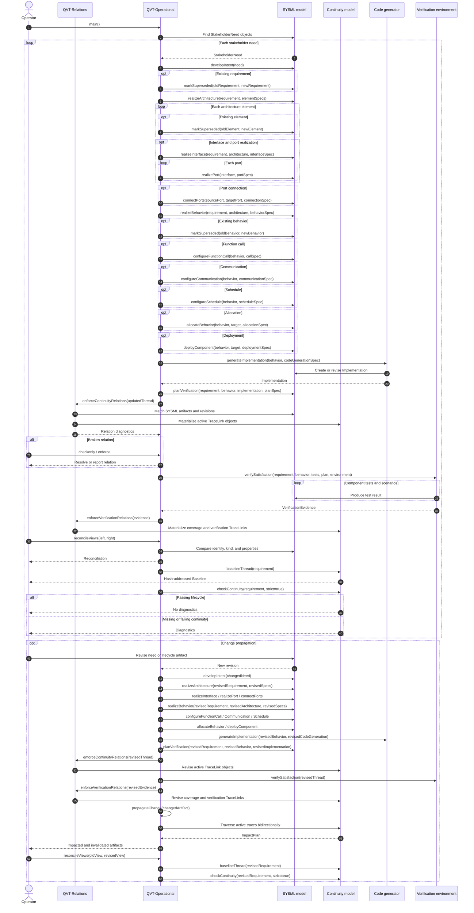

# SysML v2 QVT continuity

This repository provides a domain-neutral SysML v2 lifecycle with revisioned
artifacts and traceability contracts.

The lifecycle covers:

- intent and architecture realization;
- interfaces, ports, connections, function calls, communications, and scheduling;
- executable behavior realization and implementation generation;
- allocation, deployment, verification planning, and evidence;
- change propagation, view reconciliation, continuity checks, and baselines.

The battery thermal-control program is a demonstration adapter. Deterministic
code generation is a caller-supplied source renderer; it is not a battery-specific
QVT lifecycle operation.

Use `LifecycleKinds` to name artifact roles for another domain or meta-model.
Use `IdentityPolicy`/`DefaultIdentityPolicy` to control stable IDs for needs,
requirements, architecture elements, tests, and baselines. Domain values belong
in artifact properties and supplied data, not in the lifecycle engine.

## Quick start

```bash
python3 -m venv .venv
.venv/bin/python -m pip install -e .
.venv/bin/python -m pytest -q
.venv/bin/python -m sysml_v2_qvt.cli battery
```

Run a custom example data file:

```bash
.venv/bin/python -m sysml_v2_qvt.cli battery --data examples/battery_thermal.json
```

Show the change-impact shape:

```bash
.venv/bin/python -m sysml_v2_qvt.cli impact
```

## QVT roles

**QVT-Relations** declares continuity invariants. It can be used in
`checkonly` mode to report broken relations and in constrained `enforce` mode
where the relation has a clear authoritative side.

**QVT-Operational** executes lifecycle transactions: it creates and revises
artifacts, marks supersession, sequences realization and verification,
reconciles views, propagates impact, and snapshots baselines. It does not
create `TraceLink` objects.

Trace links are owned by `ContinuityRelations`: QVT-Relations declares their
invariants, and a relation pass materializes the corresponding active links
after operational transactions.

**QVT-Core** is not authored here. It is an implementation/lowering concern,
not a useful user-facing lifecycle language for this repository.

The QVT sources reference a small adapter metamodel. They demonstrate the
contract and mapping shape; the Python implementation is the executable
reference runtime until a SysML v2 MOF adapter is connected.

## End-to-end lifecycle sequence

The operational flow below uses the QVT-Operational entry points and closes
through verification, reconciliation, baselining, and change propagation.



The main operation sequence is:
`main` → `developIntent` → `realizeArchitecture` → interface/port and behavioral realization
→ allocation/deployment → `generateImplementation` → `planVerification`
→ Relations enforcement → `verifySatisfaction` → Relations enforcement
→ `reconcileViews` → `baselineThread`
→ `checkContinuity`; changed artifacts loop back through this sequence via
`propagateChange`.

## Generic lifecycle configuration

```python
from sysml_v2_qvt import Artifact, LifecycleEngine, LifecycleKinds

kinds = LifecycleKinds(
    stakeholder_need="goal",
    requirement="outcome",
    architectural_element="solution",
    behavior_element="workflow",
    verification_evidence="proof",
)
engine = LifecycleEngine(kinds=kinds)

goal = Artifact(
    id="GOAL-1",
    kind="goal",
    properties={"statement": "Complete the operation."},
)
outcome = engine.develop_intent(goal, "OUTCOME-1")
```

`generate_implementation()` accepts the source text or a renderer callback,
plus language and entry-point metadata. It never interprets domain properties:
that belongs to the selected renderer.

In the Python reference runtime, `LifecycleEngine` performs operational
transactions and `ContinuityRelations` materializes trace links for the
corresponding QVT-Relations invariants.

## Executable behavior contracts

Behavior models can describe:

- typed parameters, variables, and results;
- operations and provided/required interfaces;
- synchronous or asynchronous function calls and return bindings;
- subscriptions, publishes, commands, RPC, QoS, channels, endpoints, and timeouts;
- cyclic, periodic, one-shot, event-driven, or custom schedules;
- state transitions, guards, priorities, and actions;
- architecture allocations and runtime deployments;
- code-generation targets, entry points, build systems, dependencies, and flags;
- verification plans and execution environments.

Use `BehaviorModel`, `InterfaceSpec`, `PortSpec`, `FunctionCallSpec`,
`CommunicationSpec`, `ScheduleSpec`, `AllocationSpec`, `DeploymentSpec`, and
`CodeGenerationSpec` for typed values. Arbitrary domain metadata remains available
through each descriptor's `properties` mapping.

## Battery example

The example starts with `N-BATT-THERMAL`, derives `R-BATT-THERMAL`, realizes
four architectural elements and `B-BATT-THERMAL-CONTROL`, and deterministically
generates `C-BATT-THERMAL-CONTROL`.

It then creates:

- a structured behavior model with function calls, communications, transitions,
  and a cyclic schedule;
- allocation and deployment artifacts for the controller;
- a verification plan with component, simulation, and execution-environment coverage;
- component tests for low, high, deadband, and sensor-fault behavior;
- simulated cold-start, hot-ambient, and sensor-loss scenarios;
- verification evidence for the exact requirement, behavior, and code revisions;
- a hash-addressed baseline that closes across the full thread.

Every derived artifact is revisioned. Replacing an artifact creates a
`supersedes` trace instead of rewriting history.
