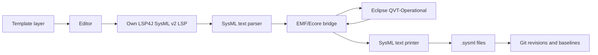
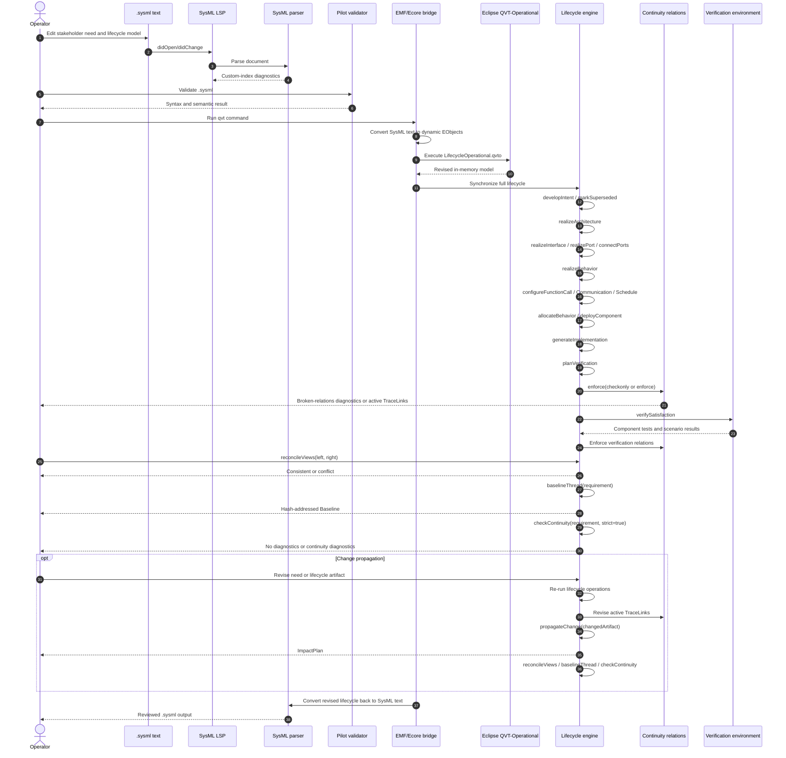

# SysML v2 lifecycle CRUD

## CRUD lifecycle model

The primary interface is CRUD over traditional V-lifecycle activities:

| CRUD operator | Meaning |
|---|---|
| `create` | Create a domain, subsystem, requirement, interface, behavior, entrypoint, test, or baseline. |
| `request` | Request/read entities and activities, optionally including deleted entities. |
| `update` | Revise an entity and generate a new revision. |
| `delete` | Mark an entity deleted without erasing history. |

List the supported lifecycle activities:

```bash

## V-lifecycle CRUD activity catalog

| Activity | Discipline | Phase | Entity kinds |
|---|---|---|---|
| Stakeholder Needs | Systems | Stakeholder Needs | Concern, change request |
| Concept of Operations | Systems | Concept | CONOPS, validation scenario |
| System Domain | Systems | System Architecture | Domain |
| System Requirements | Systems | Requirements | Requirement, constraint |
| System Architecture | Systems | System Architecture | Domain, subsystem, component, interface, port, allocation |
| Subsystem Requirements | Systems | Subsystem Design | Requirement, allocation |
| Subsystem Detailed Design | Systems | Subsystem Design | Subsystem, behavior, data type, interface |
| Software Requirements | Software | Requirements | Requirement, constraint, interface |
| Software Architecture | Software | Subsystem Design | Module, domain, interface, port |
| Software Detailed Design | Software | Subsystem Design | Behavior, entrypoint, data type |
| Software Implementation | Software | Implementation | C++ implementation, entrypoint, build target |
| Component Verification | Cross-disciplinary | Verification | Test suite, test case, verification evidence |
| Subsystem Integration | Cross-disciplinary | Integration | Subsystem, component, allocation |
| System Integration | Systems | Integration | Domain, subsystem, deployment |
| System Verification | Cross-disciplinary | Verification | Verification plan, test case, evidence |
| System Validation | Systems | Validation | Validation scenario, evidence |
| Release | Cross-disciplinary | Operations | Build target, release, baseline, deployment |
| Operations and Maintenance | Cross-disciplinary | Operations | Change request, deployment, release |bash
java -jar target/sysml-v2-qvt-continuity-1.0.0-SNAPSHOT.jar crud activities
```

Create a domain:

```bash
java -jar target/sysml-v2-qvt-continuity-1.0.0-SNAPSHOT.jar crud create \
  --activity system-domain \
  --kind DOMAIN \
  --id DOMAIN-BMS \
  --name "Battery Management System"
```

Create a subsystem under that domain:

```bash
java -jar target/sysml-v2-qvt-continuity-1.0.0-SNAPSHOT.jar crud create \
  --activity system-architecture \
  --kind SUBSYSTEM \
  --id SUB-THERMAL \
  --parent DOMAIN-BMS \
  --name "Battery Thermal Control"
```

Create a requirement:

```bash
java -jar target/sysml-v2-qvt-continuity-1.0.0-SNAPSHOT.jar crud create \
  --activity system-requirements \
  --kind REQUIREMENT \
  --id REQ-BATT-TEMP \
  --parent SUB-THERMAL \
  --name "Battery temperature range" \
  --prop:statement "Keep battery temperature between 20 C and 30 C."
```

Implement C++ behavior at a domain entrypoint:

```bash
java -jar target/sysml-v2-qvt-continuity-1.0.0-SNAPSHOT.jar crud create \
  --activity software-implementation \
  --kind CPP_IMPLEMENTATION \
  --id CPP-GENERATE-HEATER-COMMAND \
  --parent SUB-THERMAL \
  --name GenerateHeaterCommand \
  --prop:language C++20 \
  --prop:signature 'HeaterCommand generate_heater_command(double temperatureC, bool sensorValid)'
```

This generates a SysML v2 entity, C++ header, and C++ source skeleton:

```cpp
#pragma once

class GenerateHeaterCommand {
public:
    int run();
};
```

This repository uses SysML v2 text as the source model format and exposes
traditional V-lifecycle activities as CRUD operators.



## Stack

- **Java 17+** for the executable and language-server process.
- **LSP4J** for JSON-RPC language-server capabilities.
- **Official Pilot parser validator** for syntax and semantic verification of
  SysML v2 `.sysml` files.
- **CRUD lifecycle catalog** for system and software V-lifecycle activities.
- **EMF/Ecore** only at the Eclipse QVT model boundary.
- **Eclipse QVT-OML 3.11.2** for executing `qvt/LifecycleOperational.qvto`.
- **Git** for source revisions and baselines.

This repository does not use a hosted SysML v2 API. Text, trace, and baseline
data remain local to the files and Git repository.

The `.sysml` files in `examples/` use SysML v2 textual notation and are
validated with the official Systems Modeling API and Services Pilot
Implementation parser. The battery example passes with zero syntax and
semantic errors under Pilot `0.64.0-SNAPSHOT`.

Validation is the authoritative gate:

```text
syntax=0
semantic=0
```

## CRUD V-lifecycle workflow

The primary interface is CRUD for every traditional V-lifecycle activity.

```text
create  -> create a domain, subsystem, requirement, entrypoint, test, or baseline
request -> retrieve a revision or an activity-scoped entity set
update  -> revise an entity and supersede the prior revision
delete  -> mark an entity deleted while preserving history
```

For example:

```bash
java -jar target/sysml-v2-qvt-continuity-1.0.0-SNAPSHOT.jar crud create \
  --workspace . \
  --activity system-domain \
  --kind DOMAIN \
  --id DOMAIN-BMS \
  --name "Battery Management System"

java -jar target/sysml-v2-qvt-continuity-1.0.0-SNAPSHOT.jar crud create \
  --workspace . \
  --activity system-architecture \
  --kind SUBSYSTEM \
  --id SUB-THERMAL \
  --parent DOMAIN-BMS \
  --name "Battery Thermal Control"

java -jar target/sysml-v2-qvt-continuity-1.0.0-SNAPSHOT.jar crud create \
  --workspace . \
  --activity software-implementation \
  --kind CPP_IMPLEMENTATION \
  --id CPP-GENERATE-HEATER-COMMAND \
  --parent SUB-THERMAL \
  --name GenerateHeaterCommand \
  --prop:language C++20 \
  --prop:signature 'HeaterCommand generate_heater_command(double temperatureC, bool sensorValid)'
```

## Build

```bash
scripts/download-qvt-libs.sh
mvn test package
```

The build downloads pinned Eclipse QVT and MDT OCL plugin jars. The final jar
is at:

```text
target/sysml-v2-qvt-continuity-1.0.0-SNAPSHOT.jar
```

## Generate a model

```bash
java -jar target/sysml-v2-qvt-continuity-1.0.0-SNAPSHOT.jar \
  template battery --output battery.sysml
```

Generate a generic lifecycle template:

```bash
java -jar target/sysml-v2-qvt-continuity-1.0.0-SNAPSHOT.jar \
  template generic --output system.sysml
```

## Validate SysML text

```bash
java -jar target/sysml-v2-qvt-continuity-1.0.0-SNAPSHOT.jar \
  validate \
  --input battery.sysml \
  --pilot-library .build/pilot/SysML-v2-Pilot-Implementation/sysml.library
```

## Execute QVT

```bash
java -jar target/sysml-v2-qvt-continuity-1.0.0-SNAPSHOT.jar \
  qvt \
  --input battery.sysml \
  --output battery-lifecycle.sysml \
  --transformation qvt/LifecycleOperational.qvto
```

The Eclipse QVT-OML engine loads the transformation, executes it over a
dynamic EMF/Ecore view of the SysML text model, and returns revised lifecycle
artifacts. The Java lifecycle engine restores the complete former operational
scope, and the Java continuity relation pass enforces the complete former
relation scope and materializes trace links.

## End-to-end lifecycle sequence

The lifecycle closes through intent, realization, verification, reconciliation,
baselining, and change propagation.



The main operation sequence is:

```text
main
  -> developIntent
  -> realizeArchitecture
  -> realizeInterface / realizePort / connectPorts
  -> realizeBehavior
  -> configureFunctionCall / configureCommunication / configureSchedule
  -> allocateBehavior / deployComponent
  -> generateImplementation
  -> planVerification
  -> enforceContinuityRelations
  -> verifySatisfaction
  -> reconcileViews
  -> baselineThread
  -> checkContinuity
```

Changed artifacts loop back through this sequence through
`propagateChange`, active-trace traversal, and revised lifecycle operations.

## Check or enforce continuity relations

Run the Java implementation of `ContinuityRelations.qvtr` in check-only mode:

```bash
java -jar target/sysml-v2-qvt-continuity-1.0.0-SNAPSHOT.jar \
  relations --input battery.sysml --mode checkonly
```

Materialize active trace links in enforce mode:

```bash
java -jar target/sysml-v2-qvt-continuity-1.0.0-SNAPSHOT.jar \
  relations \
  --input battery.sysml \
  --mode enforce \
  --output relations.sysml
```

## Start the LSP

```bash
java -jar target/sysml-v2-qvt-continuity-1.0.0-SNAPSHOT.jar lsp
```

The server communicates over JSON-RPC stdio and provides:

- Completion for lifecycle declaration keywords.
- Hover information.
- Diagnostics for malformed declarations and missing key properties.
- Code actions for inserting battery or generic templates.
- Full-document change synchronization.
