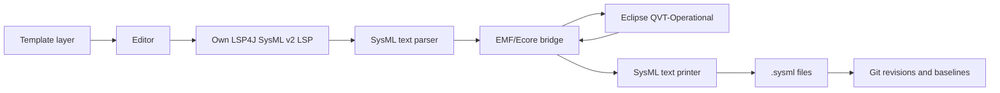
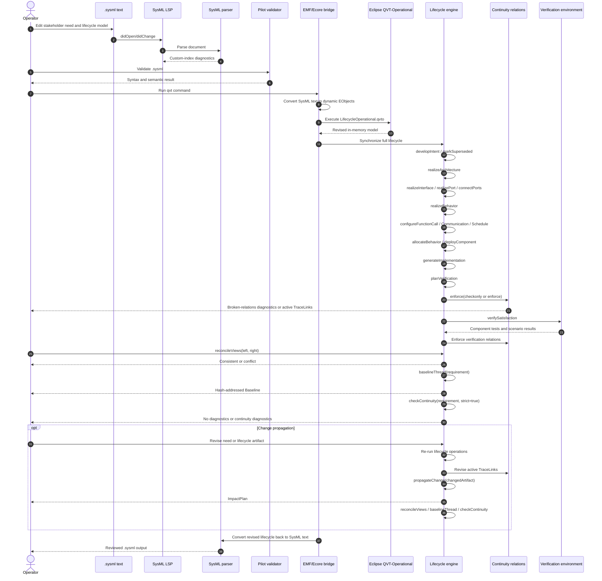

# SysML v2 QVT continuity

This repository uses SysML v2 text as the source model format and Eclipse
QVTd 3.11.2 as the operational transformation engine.



## Stack

- **Java 17+** for the executable and language-server process.
- **LSP4J** for JSON-RPC language-server capabilities.
- **Official Pilot parser validator** for syntax and semantic verification of
  SysML v2 `.sysml` files.
- **Template library** for creating stakeholder needs, requirements,
  architecture, behavior, verification, and evidence.
- **EMF/Ecore** only at the Eclipse QVT model boundary.
- **Eclipse QVT-OML 3.11.2** for executing `qvt/LifecycleOperational.qvto`.
- **Git** for source revisions and baselines.

This repository does not use a hosted SysML v2 API. Text, trace, and baseline
data remain local to the files and Git repository.

The `.sysml` files in `examples/` use SysML v2 textual notation and are
validated with the official Systems Modeling API and Services Pilot
Implementation parser. The battery example passes with zero syntax and
semantic errors under Pilot `0.64.0-SNAPSHOT`.

Validation is the authoritative gate:

```text
syntax=0
semantic=0
```

## Build

```bash
scripts/download-qvt-libs.sh
mvn test package
```

The build downloads pinned Eclipse QVT and MDT OCL plugin jars. The final jar
is at:

```text
target/sysml-v2-qvt-continuity-1.0.0-SNAPSHOT.jar
```

## Generate a model

```bash
java -jar target/sysml-v2-qvt-continuity-1.0.0-SNAPSHOT.jar \
  template battery --output battery.sysml
```

Generate a generic lifecycle template:

```bash
java -jar target/sysml-v2-qvt-continuity-1.0.0-SNAPSHOT.jar \
  template generic --output system.sysml
```

## Validate SysML text

```bash
java -jar target/sysml-v2-qvt-continuity-1.0.0-SNAPSHOT.jar \
  validate \
  --input battery.sysml \
  --pilot-library .build/pilot/SysML-v2-Pilot-Implementation/sysml.library
```

## Execute QVT

```bash
java -jar target/sysml-v2-qvt-continuity-1.0.0-SNAPSHOT.jar \
  qvt \
  --input battery.sysml \
  --output battery-lifecycle.sysml \
  --transformation qvt/LifecycleOperational.qvto
```

The Eclipse QVT-OML engine loads the transformation, executes it over a
dynamic EMF/Ecore view of the SysML text model, and returns revised lifecycle
artifacts. The Java lifecycle engine restores the complete former operational
scope, and the Java continuity relation pass enforces the complete former
relation scope and materializes trace links.

## End-to-end lifecycle sequence

The lifecycle closes through intent, realization, verification, reconciliation,
baselining, and change propagation.



The main operation sequence is:

```text
main
  -> developIntent
  -> realizeArchitecture
  -> realizeInterface / realizePort / connectPorts
  -> realizeBehavior
  -> configureFunctionCall / configureCommunication / configureSchedule
  -> allocateBehavior / deployComponent
  -> generateImplementation
  -> planVerification
  -> enforceContinuityRelations
  -> verifySatisfaction
  -> reconcileViews
  -> baselineThread
  -> checkContinuity
```

Changed artifacts loop back through this sequence through
`propagateChange`, active-trace traversal, and revised lifecycle operations.

## Check or enforce continuity relations

Run the Java implementation of `ContinuityRelations.qvtr` in check-only mode:

```bash
java -jar target/sysml-v2-qvt-continuity-1.0.0-SNAPSHOT.jar \
  relations --input battery.sysml --mode checkonly
```

Materialize active trace links in enforce mode:

```bash
java -jar target/sysml-v2-qvt-continuity-1.0.0-SNAPSHOT.jar \
  relations \
  --input battery.sysml \
  --mode enforce \
  --output relations.sysml
```

## Start the LSP

```bash
java -jar target/sysml-v2-qvt-continuity-1.0.0-SNAPSHOT.jar lsp
```

The server communicates over JSON-RPC stdio and provides:

- Completion for lifecycle declaration keywords.
- Hover information.
- Diagnostics for malformed declarations and missing key properties.
- Code actions for inserting battery or generic templates.
- Full-document change synchronization.
