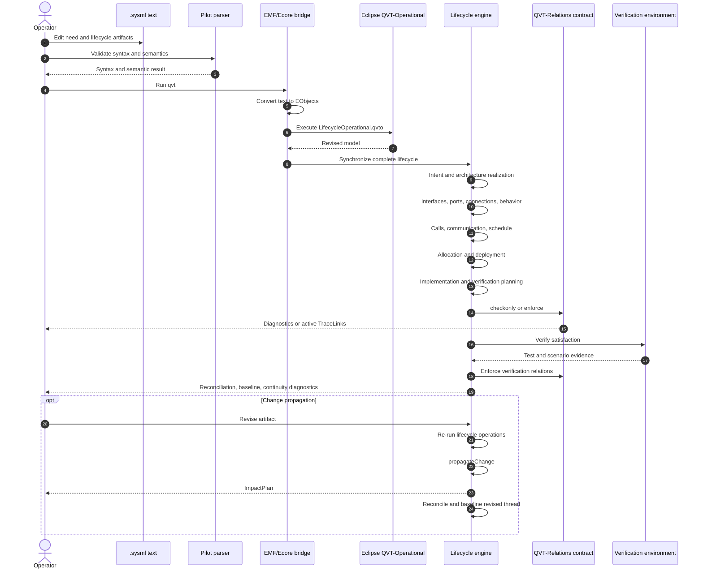

# Legacy QVT sources

QVT is retained for compatibility and executable lifecycle lower-level
implementation. The primary interface is CRUD:

```text
Create  -> new domain/subsystem/requirement/behavior/implementation/test
Request -> retrieve entity or activity-set revisions
Update  -> revision replacement and supersession
Delete  -> preserve history while marking the entity deleted
```

The legacy V-lifecycle operation model is retained as a compatibility
transformation, but the primary model interface is CRUD:

| Operator | Legacy lifecycle effect |
|---|---|
| Create | Create a domain, subsystem, requirement, interface, behavior, implementation, test, or baseline. |
| Request | Read/retrieve an entity or activity set. |
| Update | Create a new revision and supersede the prior version. |
| Delete | Mark the entity deleted while retaining its history. |

`LifecycleOperational.qvto` is an executable Eclipse QVT-OML transformation
with the former operational scope:

- `markSuperseded`
- `developIntent`
- `realizeArchitecture`
- `realizeInterface`
- `realizePort`
- `connectPorts`
- `realizeBehavior`
- `configureFunctionCall`
- `configureCommunication`
- `configureSchedule`
- `allocateBehavior`
- `deployComponent`
- `generateImplementation`
- `planVerification`
- `verifySatisfaction`
- `propagateChange`
- `reconcileViews`
- `baselineThread`
- `checkContinuity`

The Java application converts repository `.sysml` text into EMF/Ecore objects,
runs Eclipse QVT-OML, and converts the revised model back to SysML text.

`ContinuityRelations.qvtr` records the full declarative continuity relation
contract. It covers:

- artifact supersession;
- stakeholder need to requirement origin;
- requirement realization by architecture;
- architecture interface and port exposure;
- port-to-port connections;
- architecture support of behavior;
- behavior function calls;
- behavior communication;
- behavior scheduling;
- behavior allocation;
- component deployment;
- behavior implementation;
- verification-plan evidence;
- test coverage and execution.

The Java `ContinuityRelations` implementation enforces this complete scope,
supports `checkonly` diagnostics and `enforce` trace materialization, and
materializes active links. Direct execution of the `.qvtr` file by a QVT
Relations engine remains a separate integration.

## End-to-end lifecycle sequence


